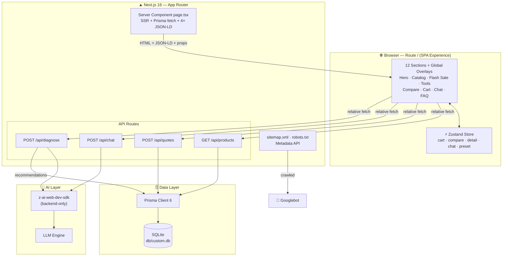
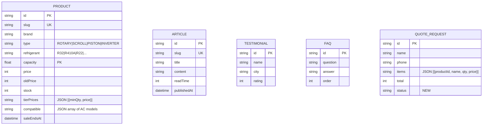

<div align="center">


# ⚡ JURAGAN KOMPRESOR

### *Your AC's Heart, Handled by the Boss.*

**Indonesia's #1 AC compressor super web app** — distilled from research on 20 competitor websites, powered by AI, and engineered to rank #1 on Google.

[](README.md)
[](README.en.md)

[](https://nextjs.org)
[](https://www.typescriptlang.org)
[](https://tailwindcss.com)
[](https://ui.shadcn.com)
[](https://www.prisma.io)
[](https://www.framer.com/motion/)
[](https://github.com/pmndrs/zustand)
[](https://z.ai)

</div>

---

## 📑 Table of Contents

- [About the Project](#-about-the-project)
- [Methodology: 20 Websites, 1 Super App](#-methodology-20-websites-1-super-app)
- [Key Features](#-key-features)
- [System Architecture](#-system-architecture)
- [Technology Stack](#-technology-stack)
- [Quick Start](#-quick-start)
- [Available Scripts](#-available-scripts)
- [API Reference](#-api-reference)
- [Data Model](#-data-model)
- [Project Structure](#-project-structure)
- [Design System](#-design-system)
- [SEO Arsenal](#-seo-arsenal)
- [AI Capabilities](#-ai-capabilities)
- [Quality Assurance](#-quality-assurance)
- [Roadmap](#-roadmap)
- [Contributing](#-contributing)
- [License](#-license)
- [Acknowledgments](#-acknowledgments)

---

## 🎯 About the Project

**JURAGAN KOMPRESOR** ("The Compressor Boss") is not just another online store. It is a **super web app** born from one ambitious question:

> *What if we took the 10 best features from 20 AC compressor e-commerce websites in Indonesia, distilled them, and rebuilt everything into a single application that outperforms them all — architected from the very first line of code to dominate Google search results?*

The answer lives here: a full-stack application featuring **31 real compressor SKUs** (rotary, scroll, piston, inverter), **20 world-class brands**, a 24/7 HVAC AI assistant, and an LLM-powered fault diagnosis engine — all within a single route that is instant, beautiful, and maximally SEO-optimized.

| Summary | Detail |
|---|---|
| 🧩 Type | E-commerce Super Web App (Single-Page Experience, SSR-first) |
| 📦 Catalog | 31 compressor products · 20 brands · 4 technologies (Rotary/Scroll/Piston/Inverter) |
| 🤖 AI | Consultation chat · Fault diagnosis · Automatic product recommendations |
| 🔍 SEO | 4 JSON-LD schemas · sitemap.xml · robots.txt · OpenGraph id-ID |
| 🎨 Design | "Juragan" orange + dark zinc · Plus Jakarta Sans · full Framer Motion animation |
| 🗄️ Database | SQLite via Prisma ORM (zero-config, production-ready pattern) |

---

## 🔬 Methodology: 20 Websites, 1 Super App

Before a single line of code was written, competitive research was conducted on **20 AC compressor sales websites**, curated into 4 categories:

| Category | Websites Analyzed |
|---|---|
| 🛒 **Marketplaces** | Tokopedia, Shopee, Bukalapak, Blibli, Lazada |
| 🔧 **AC Spare Part Specialists** | Inti Jaya, Putra Jaya Abadi, Victoria Jaya, Sumber Mandiri, Indo Climates, Sejahtera Indo Cool |
| 🏭 **Official Distributors** | Tiris Global, Polarin, Polarin Xinindo, Global Cool, Vision Sinergi GMCC |
| 🌐 **B2B & International** | Indotrading, Alibaba, Copeland Locator, Danfoss Product Store |

From this research, the **10 highest-frequency features** were extracted — all fully implemented here:

1. ✅ Comprehensive technical filters (brand, PK, refrigerant, compressor technology, price)
2. ✅ **100% Original** badges & official warranty on every product
3. ✅ B2B RFQ (Request for Quotation) with automatic order reference numbers
4. ✅ Search by model code + a **compatibility checker** (cross-reference)
5. ✅ WhatsApp checkout with pre-formatted order details
6. ✅ Verified ratings, reviews & "units sold" counters
7. ✅ **Quantity tiered wholesale pricing**
8. ✅ Flash sales with live countdown & sold-progress bars
9. ✅ SEO educational content (*Kompresorpedia*)
10. ✅ Trust/USP landing sections

**Plus 3 brilliant differentiators that none of the 20 competitors offer:**

| Differentiator | Description |
|---|---|
| 🧠 **Tanya Juragan** | An AI assistant that understands the entire real-time catalog and answers in Indonesian |
| 🩺 **Compressor Diagnosis** | Pick symptoms → LLM analyzes severity → product recommendations straight from the database |
| 📐 **PK Calculator** | Calculate required PK based on room size & floor level → one click filters the catalog |

---

## ✨ Key Features

### 🛍️ Shopping Experience
- **Smart catalog** — real-time search, multi-dimensional filters (brand / type / refrigerant / PK / price range), 5 sort modes, *load-more*, and a designed *empty state*
- **Product detail drawer** — full specifications, feature list, compatible AC units, WhatsApp CTA
- **Dynamic tier pricing** — price adapts to quantity automatically (e.g., qty 3 → Rp 1,137,600/unit = Rp 3,412,800 total, calculated live)
- **4-product comparison** — persistent bottom bar + a 10-row comparison table with an automatic **CHEAPEST** badge
- **Cart + RFQ** — quantity stepper, Zod-validated form, orders persisted to the database with a `JK-XXXXXXXX` reference number, then a WhatsApp checkout button with full itemized details
- **Flash sale** — per-second live countdown (SSR-safe), "claimed" progress bar, automatic discounts

### 🧠 Artificial Intelligence
- **Tanya Juragan (AI chat)** — floating FAB + chat panel, *quick-reply chips*, typing indicator, lightweight markdown rendering; the system prompt embeds a snapshot of all 31 products, so recommendations are always real — never hallucinated
- **Fault diagnosis** — 8 common symptoms → structured LLM JSON analysis (`severity` / `diagnosis` / `action` / suggested compressor specs) → DB product matching → **rule-based fallback** if the LLM fails (zero downtime)
- **Compatibility checker** — enter an old AC model code (e.g., `FTV15`) → fuzzy-matches to a compatible replacement compressor

### 📐 Technical Tools
- **PK calculator** — room-size slider + upstairs switch → real-time BTU & PK result → one click filters the catalog (full Zustand integration)
- **Diagnosis & calculator** are wired into the catalog — not dead-end widgets

### 🎬 Visual & UI Experience
- Full Framer Motion animation: *count-up stats*, *20-brand marquee*, floating chips, *scroll-triggered reveals*, micro-interactions on every button
- Sticky navbar with blur effect, live cart/compare badges, native-feeling mobile bottom sheets
- A correctly **sticky footer** (never floats on short pages, pushed naturally on long ones) + iOS *safe-area* aware
- Accessibility: semantic HTML (`main`/`section`/`article`), `aria-label`, `sr-only`, WCAG contrast, ≥ 44px touch targets
- Mobile-first responsive — verified across 390×844 to 1440×900 viewports

---

## 🏗️ System Architecture



**Architectural principles:**

1. **SSR-first for SEO** — all catalog, article, FAQ, and testimonial content renders server-side and is crawlable by Googlebot without executing JavaScript.
2. **API Routes, not Server Actions** — all mutations & dynamic queries pass through Zod-validated REST endpoints; easy to test, cache, and re-consume.
3. **Hydration-safety by design** — all non-deterministic values (`Date.now()`, locale, timezone) are isolated from the initial render; dates are formatted deterministically in WIB (UTC+7).
4. **AI stays on the backend** — `z-ai-web-dev-sdk` is only ever imported inside API routes; keys & prompts never leak to the client.

---

## 🛠️ Technology Stack

| Layer | Technology | Version | Why It Was Chosen |
|---|---|---|---|
| Framework | [Next.js](https://nextjs.org) (App Router, Turbopack) | 16 | SSR/SSG hybrid, Metadata API, latest-generation performance |
| Language | [TypeScript](https://www.typescriptlang.org) | 5 | End-to-end *strict typing*, from DB schema to UI props |
| Styling | [Tailwind CSS](https://tailwindcss.com) | 4 | Utility-first, theme tokens via CSS `oklch`, fast builds |
| UI Components | [shadcn/ui](https://ui.shadcn.com) (New York) | — | 45+ ready Radix components with full code ownership |
| Animation | [Framer Motion](https://www.framer.com/motion/) | 12 | Physical animations, `whileInView`, gestures, layout animation |
| State | [Zustand](https://github.com/pmndrs/zustand) | 5 | Minimalist client state + `subscribe` for cross-component presets |
| Database | SQLite + [Prisma](https://www.prisma.io) | 6 | Zero-config, type-safe queries, declarative migrations |
| Validation | [Zod](https://zod.dev) | 4 | A single validation schema for the API boundary |
| AI | [z-ai-web-dev-sdk](https://z.ai) | 0.0.18 | Backend LLM chat completions, no manual key management |
| Icons | [Lucide React](https://lucide.dev) | — | Consistent, *tree-shakeable* icons |
| Toasts | [Sonner](https://sonner.emilkowal.ski) | 2 | Elegant, *dark-mode*-ready notifications |
| Runtime | [Bun](https://bun.sh) | 1.3 | Blazing-fast installs & execution |

---

## 🚀 Quick Start

### Prerequisites

| Tool | Minimum Version | Verify |
|---|---|---|
| [Bun](https://bun.sh) | ≥ 1.1 | `bun --version` |
| Git | ≥ 2.30 | `git --version` |

> 💡 **No Bun?** Node.js ≥ 20 is also supported (swap `bun` with `npm`/`pnpm`/`yarn`).

### Installation

```bash
# 1️⃣ Clone the repository
git clone https://github.com/juragankompresor/juragan-kompresor.git
cd juragan-kompresor

# 2️⃣ Install dependencies
bun install

# 3️⃣ Configure the environment
echo 'DATABASE_URL=file:./db/custom.db' > .env

# 4️⃣ Push the schema to the database
bun run db:push

# 5️⃣ Seed initial data (31 products, 6 articles, 6 testimonials, 8 FAQs)
bun prisma/seed.ts

# 6️⃣ Start the dev server
bun run dev
```

Open **[http://localhost:3000](http://localhost:3000)** — welcome to the Juragan! 🎉

<details>
<summary>🔧 <strong>Production Build</strong> (click to expand)</summary>

```bash
# Build the standalone output
bun run build

# Run the production server
bun run start
```

The build uses Next.js **standalone** mode — output is automatically copied to `.next/standalone/` along with `public/` and `.next/static` assets.

</details>

<details>
<summary>🔄 <strong>Database Reset</strong> (click to expand)</summary>

```bash
bun run db:reset    # drop + recreate the database, then rerun migrations
bun run db:push     # sync the schema without migrations (fast, for dev)
bun run db:generate # regenerate Prisma Client after editing schema.prisma
```

</details>

---

## 📜 Available Scripts

| Command | Description |
|---|---|
| `bun run dev` | Development server on port `3000` (logs to `dev.log`) |
| `bun run build` | Standalone production build + static asset copy |
| `bun run start` | Run the production server from the build output |
| `bun run lint` | Full ESLint (including strict react-hooks rules) |
| `bun run db:push` | Push `prisma/schema.prisma` to SQLite |
| `bun run db:generate` | Generate the Prisma Client |
| `bun run db:migrate` | Development migration with tracked changes |
| `bun run db:reset` | Fully reset the database |

---

## 🔌 API Reference

Base URL: `http://localhost:3000` · All bodies use `application/json`.

### `GET /api/products` — Catalog + Filters

| Query Param | Type | Description |
|---|---|---|
| `search` | string | Searches name, brand, model code, compatibility, description |
| `brand` | string | Exact brand filter (e.g., `Daikin`) |
| `type` | string | `ROTARY` · `SCROLL` · `PISTON` · `INVERTER` |
| `refrigerant` | string | `R32` · `R410A` · `R22` · `R134a` · `R404A` |
| `category` | string | `RESIDENTIAL` · `LIGHT_COMMERCIAL` · `INDUSTRIAL` |
| `minPk` / `maxPk` | number | Capacity range (PK) |
| `minPrice` / `maxPrice` | number | Price range (Rupiah) |
| `sort` | string | `populer` *(default)* · `termurah` · `termahal` · `rating` · `terbaru` |
| `limit` | number | Max 100 (default 60) |

```bash
curl "http://localhost:3000/api/products?brand=Daikin&type=ROTARY&minPk=1&maxPk=2&sort=termurah"
```

```jsonc
{
  "products": [
    {
      "id": "cmvfpog4x0000qhbfor6a1hfa",
      "slug": "daikin-jt90bcbby1l-1pk-r32",
      "name": "Kompresor AC Daikin Rotary JT90BCBY1L 1 PK R32",
      "brand": "Daikin", "type": "ROTARY", "refrigerant": "R32",
      "capacity": 1, "voltage": "220V / 1 Fase", "modelCode": "JT90BCBY1L",
      "price": 1185000, "oldPrice": 1450000, "stock": 42, "soldCount": 1284,
      "rating": 4.9, "badge": "Terlaris", "warranty": "Garansi resmi 1 tahun",
      "features": ["..."], "compatible": ["..."], "tierPrices": [{ "minQty": 1, "price": 1185000 }],
      "saleEndsAt": "2026-10-20T15:00:00.000Z"
    }
  ],
  "total": 1
}
```

### `POST /api/quotes` — Save Order (RFQ)

```bash
curl -X POST http://localhost:3000/api/quotes \
  -H "Content-Type: application/json" \
  -d '{
    "name": "Budi Santoso",
    "phone": "081234567890",
    "address": "Jl. Raya Bogor No. 12, Jakarta Timur",
    "note": "Deliver in the afternoon please",
    "items": [{ "productId": "cmvfpog4x0000qhbfor6a1hfa", "name": "Daikin 1PK Compressor", "qty": 2, "price": 1185000 }]
  }'
```

```jsonc
{
  "ok": true,
  "quoteId": "JK-TVBF7VBA",          // order reference number
  "total": 2370000,
  "waLink": "https://wa.me/6281234567890?text=..."  // auto-formatted WhatsApp checkout
}
```

> Strict Zod validation: name ≥ 2 chars, phone ≥ 8 digits, address ≥ 5 chars, ≥ 1 item, qty 1–999.

### `POST /api/chat` — "Tanya Juragan" AI Assistant

```bash
curl -X POST http://localhost:3000/api/chat \
  -H "Content-Type: application/json" \
  -d '{ "messages": [{ "role": "user", "content": "Which 1.5 PK R32 compressor lasts the longest?" }] }'
```

```jsonc
{ "reply": "For a 1.5 PK R32, check out the Daikin JT110... Shall I find you the best match?" }
```

> The system prompt injects a catalog snapshot (name, brand, PK, refrigerant, price, stock), so recommendations are always grounded in real data. History is capped at 12 messages × 2,000 characters.

### `POST /api/diagnose` — AI Fault Diagnosis

```bash
curl -X POST http://localhost:3000/api/diagnose \
  -H "Content-Type: application/json" \
  -d '{ "symptoms": ["tidak-dingin", "suara-berisik"], "brand": "Daikin", "capacity": 1 }'
```

```jsonc
{
  "severity": "SEDANG",
  "diagnosis": "The combination of weak cooling + noise suggests ...",
  "action": ["Measure compressor current...", "Check refrigerant pressure...", "..."],
  "suggestedPk": 1, "suggestedType": "ROTARY", "suggestedRefrigerant": "R32",
  "products": [ /* 3 best-matching catalog products */ ]
}
```

> Supported symptoms: `tidak-dingin`, `mcb-jatuh`, `suara-berisik`, `outdoor-panas`, `bau-gosong`, `pipa-beku`, `on-off-sendiri`, `umur-tua`. If the LLM is unavailable, a **rule-based fallback** takes over automatically.

### Other Endpoints

| Endpoint | Method | Purpose |
|---|---|---|
| `/api` | GET | Health check |
| `/sitemap.xml` | GET | Dynamic generated sitemap |
| `/robots.txt` | GET | Crawler rules + sitemap reference |

---

## 🗄️ Data Model



> 📐 A **JSON-as-String** pattern is used for semi-structured fields (`features`, `compatible`, `tierPrices`, `items`) — a deliberate trade-off for lightweight SQLite, with safe validated parsing in `src/lib/serialize.ts`.

---

## 📁 Project Structure

```text
juragan-kompresor/
├── prisma/
│   ├── schema.prisma          # 5 models: Product, Article, Testimonial, Faq, QuoteRequest
│   └── seed.ts                # Seeds 31 products + 6 articles + 6 testimonials + 8 FAQs
├── db/
│   └── custom.db              # SQLite database
├── public/
│   ├── images/                # AI-generated assets (hero, 4 product shots per technology, OG image)
│   └── logo.svg
├── src/
│   ├── app/
│   │   ├── layout.tsx         # Full SEO metadata + fonts + Toaster
│   │   ├── page.tsx           # RSC: Prisma fetch + 4 JSON-LD + 12-section composition
│   │   ├── globals.css        # oklch orange theme + keyframes + scrollbar styling
│   │   ├── sitemap.ts         # Dynamic sitemap
│   │   ├── robots.ts          # Dynamic robots.txt
│   │   └── api/
│   │       ├── products/      # GET — catalog + filters
│   │       ├── quotes/        # POST — RFQ + WhatsApp link
│   │       ├── chat/          # POST — catalog-aware AI assistant
│   │       └── diagnose/      # POST — LLM diagnosis + fallback
│   ├── components/
│   │   ├── ui/                # 45+ shadcn/ui components (New York)
│   │   └── juragan/           # 19 domain components: hero, catalog, flash-sale,
│   │                          # compare, cart-sheet, tools, chat-widget, footer, ...
│   ├── hooks/                 # use-toast, use-mobile
│   └── lib/
│       ├── db.ts              # Prisma Client singleton
│       ├── types.ts           # End-to-end domain types
│       ├── serialize.ts       # JSON safe-parse + formatIDR + formatDateID (deterministic WIB)
│       └── store.ts           # Zustand: cart, compare, detail, chat, preset + tierPriceFor()
└── worklog.md                 # All-agent work record (research → build → verify)
```

---

## 🎨 Design System

<div align="center">

| Token | Value | Usage |
|---|---|---|
| 🟠 `Primary` | `oklch(0.646 0.222 41.116)` — Orange 600 | CTAs, prices, badges, brand accents |
| 🟡 `Accent` | Amber 500 gradient | Flash sale, highlights |
| ⬛ `Surface Dark` | Zinc 950 + grid pattern | Hero, footer, dramatic contrast |
| ⬜ `Surface Light` | White / Zinc 50 | Catalog, articles, FAQ |

</div>

- **Typography**: [Plus Jakarta Sans](https://fonts.google.com/specimen/Plus+Jakarta+Sans) — a modern identity signature of Indonesian digital products; hierarchy spans 11px → 3.4rem.
- **Animation**: custom keyframes `marquee`, `float`, `shine`, `pulse-soft`, `bounce-dot` + Framer Motion orchestration.
- **Color momentum**: orange = "juragan" energy (trading, assertive, warm) — deliberately steering away from generic blue/indigo.

---

## 🔍 SEO Arsenal

Strategy: **dominate the "kompresor AC" long-tail** with an uncompromising technical foundation.

| Layer | Implementation |
|---|---|
| 📄 **Metadata API** | Title template, 20+ targeted keywords, canonical, OpenGraph `id_ID`, Twitter Card, `robots: max-image-preview:large` |
| 🧩 **Structured Data** | 4 SSR JSON-LD schemas: `Organization`, `WebSite` + `SearchAction` (sitelinks searchbox!), `ItemList` with 12 `Product` entries complete with `Offer` + `AggregateRating`, and `FAQPage` |
| 🗺️ **Sitemap & Robots** | Dynamic `sitemap.xml` + `robots.txt`, automatically following the data |
| ⚡ **Core Web Vitals** | RSC streaming, `next/image` with hero `priority`, self-hosted fonts, minimal client component code |
| 📝 **SEO Content** | *Kompresorpedia* — 6 keyword-rich educational articles (buying guide, R32 vs R410A, failure signs, replacement costs, maintenance) |
| ♿ **Signals** | Semantic HTML, ARIA, mobile-first — ranking factors competitors routinely ignore |

---

## 🧠 AI Capabilities

| Capability | Mechanism | Resilience |
|---|---|---|
| 💬 Catalog-aware chat | 31-product snapshot embedded in the system prompt → answers cite real products + prices + stock | Length & history validation, graceful error handling |
| 🩺 Structured diagnosis | LLM is forced to emit JSON (`severity`/`action`/suggestions) → strictly parsed | Full **rule-based fallback** when the LLM fails |
| 🎯 Product recommendations | AI output → tiered Prisma queries (narrow match → PK ±0.5 → featured products) | Always returns results |

> 🔒 **Security**: the AI SDK is only ever called server-side (API routes). No keys, prompts, or SDK code are ever exposed to the browser.

---

## ✅ Quality Assurance

This project was verified **end-to-end in a real browser** (not just a passing build):

- 🧪 20 screenshot verification artifacts (hero → catalog → detail → checkout → compare → tools → chat → mobile)
- 💳 Golden-path flows tested: quote `JK-TVBF7VBA` persisted to DB + working WhatsApp button
- 🧮 Tier pricing verified live (qty 3 → total Rp 3,412,800 calculated automatically)
- 🤖 AI chat answering with real catalog data; AI diagnosis producing numbered action steps
- 📱 Responsiveness verified at 390×844 & 1440×900; correct sticky footer in both orientations
- 🧷 **Hydration-safety audited**: deterministic WIB dates, SSR-safe countdown (`null` → rAF), strict `react-hooks` lint passing clean
- 🌐 `sitemap.xml` & `robots.txt` responding with HTTP 200

---

## 🗺️ Roadmap

- [ ] 🔐 Authentication & admin dashboard (NextAuth v4) — manage products/orders
- [ ] 📊 Per-product price history (inspired by marketplace price trackers)
- [ ] 💳 Payment gateway + escrow (differentiator #3 from research)
- [ ] 📍 City-based distributor locator
- [ ] 🌍 Runtime i18n (next-intl already in dependencies)
- [ ] 📱 PWA + installable + flash-sale push notifications
- [ ] 🐘 PostgreSQL upgrade as traffic demands
- [ ] ⭐ Verified buyer reviews (form + moderation)

---

## 🤝 Contributing

1. Fork → feature branch (`feat/your-feature`)
2. Ensure `bun run lint` is clean before committing
3. Follow conventions: strict TypeScript, shadcn/ui components first, `use client` only when necessary
4. Pull requests with a description + screenshots for UI changes

> 📋 All architectural decisions are recorded in [`worklog.md`](worklog.md) — read it before contributing.

---

## 📄 License

This project is licensed under the **MIT License** — free to use, modify, and commercialize with attribution.

---

## 🙏 Acknowledgments

**Assembled from research on 20 websites** — marketplaces, specialist stores, official distributors, and international B2B portals — whose best features were distilled and rebuilt on a more modern foundation:

<div align="center">

`Tokopedia` · `Shopee` · `Bukalapak` · `Blibli` · `Lazada` · `Inti Jaya` · `Putra Jaya Abadi` · `Victoria Jaya` · `Sumber Mandiri` · `Indo Climates` · `Sejahtera Indo Cool` · `Tiris Global` · `Polarin` · `Polarin Xinindo` · `Global Cool` · `Vision Sinergi GMCC` · `Indotrading` · `Alibaba` · `Copeland Locator` · `Danfoss Product Store`

</div>

<div align="center">

---

**⚡ JURAGAN KOMPRESOR** — *Built with an engineer's precision, a designer's taste, and a boss's ambition.*

**🇬🇧 English** | [🇮🇩 Bahasa Indonesia](README.md)

</div>
