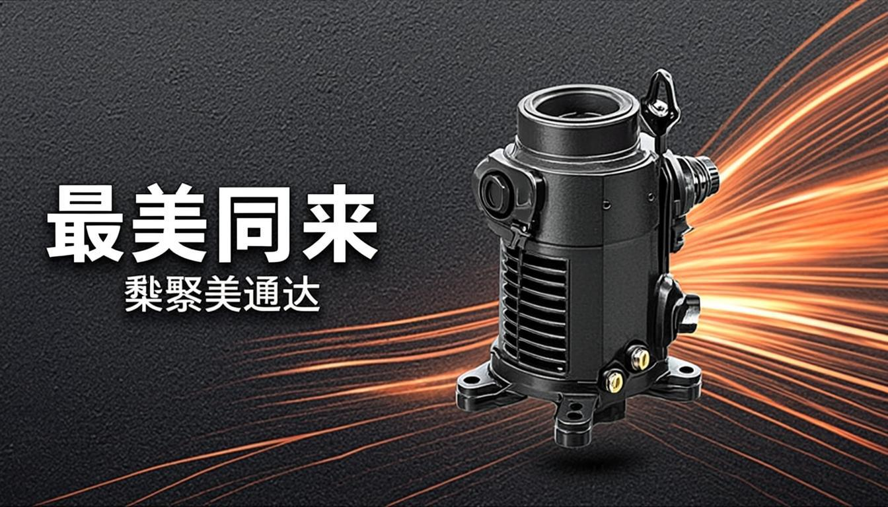
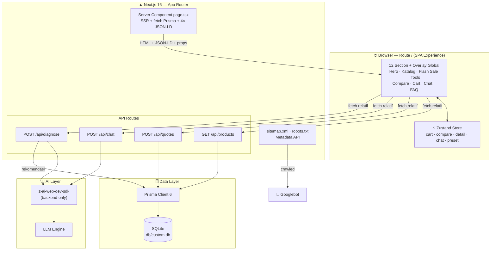
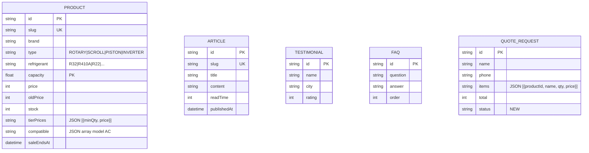

<div align="center">



# ⚡ JURAGAN KOMPRESOR

### *Jantung AC Kamu, Urusan Juragan.*

**Super Web App penjualan kompresor AC #1 Indonesia** — distilasi dari riset 20 website kompetitor terbaik, ditenagai AI, dan direkayasa untuk peringkat #1 Google.

[](README.md)
[](README.en.md)

[](https://nextjs.org)
[](https://www.typescriptlang.org)
[](https://tailwindcss.com)
[](https://ui.shadcn.com)
[](https://www.prisma.io)
[](https://www.framer.com/motion/)
[](https://github.com/pmndrs/zustand)
[](https://z.ai)

</div>

---

## 📑 Daftar Isi

- [Tentang Proyek](#-tentang-proyek)
- [Metodologi: 20 Website, 1 Super App](#-metodologi-20-website-1-super-app)
- [Fitur Unggulan](#-fitur-unggulan)
- [Arsitektur Sistem](#-arsitektur-sistem)
- [Teknologi](#-teknologi)
- [Memulai Cepat](#-memulai-cepat)
- [Skrip yang Tersedia](#-skrip-yang-tersedia)
- [Referensi API](#-referensi-api)
- [Model Data](#-model-data)
- [Struktur Proyek](#-struktur-proyek)
- [Design System](#-design-system)
- [Arsenal SEO](#-arsenal-seo)
- [Kapabilitas AI](#-kapabilitas-ai)
- [Jaminan Kualitas](#-jaminan-kualitas)
- [Roadmap](#-roadmap)
- [Kontribusi](#-kontribusi)
- [Dibuat Oleh](#-dibuat-oleh)
- [Lisensi](#-lisensi)
- [Penghargaan](#-penghargaan)

---

## 🎯 Tentang Proyek

**JURAGAN KOMPRESOR** bukan sekadar toko online. Ia adalah **super web app** yang lahir dari satu pertanyaan ambisius:

> *Bagaimana jika kita ambil 10 fitur terbaik dari 20 website penjualan kompresor AC di Indonesia, distilasi, lalu rakit ulang menjadi satu aplikasi yang lebih unggul dari semuanya — sekaligus dirancang sejak baris pertama untuk mendominasi hasil pencarian Google?*

Jawabannya ada di sini: satu aplikasi full-stack dengan **31 SKU kompresor asli** (rotary, scroll, piston, inverter), **20 merk dunia**, asisten AI ahli pendinginan 24 jam, hingga mesin diagnosa kerusakan berbasis LLM — semuanya dalam satu route yang instan, indah, dan ter-SEO-kan maksimal.

| Ringkasan | Detail |
|---|---|
| 🧩 Tipe | Super Web App E-commerce (Single-Page Experience, SSR-first) |
| 📦 Katalog | 31 produk kompresor · 20 merk · 4 teknologi (Rotary/Scroll/Piston/Inverter) |
| 🤖 AI | Chat konsultasi · Diagnosa kerusakan · Rekomendasi produk otomatis |
| 🔍 SEO | 4 JSON-LD schema · sitemap.xml · robots.txt · OpenGraph id-ID |
| 🎨 Desain | Oranye "juragan" + zinc gelap · Plus Jakarta Sans · animasi Framer Motion penuh |
| 🗄️ Database | SQLite via Prisma ORM (zero-config, production-ready pattern) |

---

## 🔬 Metodologi: 20 Website, 1 Super App

Sebelum satu baris kode ditulis, dilakukan riset kompetitif terhadap **20 website penjualan kompresor AC** yang dikurasi ke dalam 4 kategori:

| Kategori | Website yang Dianalisis |
|---|---|
| 🛒 **Marketplace** | Tokopedia, Shopee, Bukalapak, Blibli, Lazada |
| 🔧 **Toko Spesialis Sparepart AC** | Inti Jaya, Putra Jaya Abadi, Victoria Jaya, Sumber Mandiri, Indo Climates, Sejahtera Indo Cool |
| 🏭 **Distributor Resmi** | Tiris Global, Polarin, Polarin Xinindo, Global Cool, Vision Sinergi GMCC |
| 🌐 **B2B & Internasional** | Indotrading, Alibaba, Copeland Locator, Danfoss Product Store |

Dari riset tersebut diekstrak **10 fitur berfrekuensi tertinggi** — semuanya terimplementasi di sini:

1. ✅ Filter teknis lengkap (merk, PK, refrigerant, teknologi, harga)
2. ✅ Badge **100% Original** & garansi resmi di setiap produk
3. ✅ RFQ (Request for Quotation) B2B dengan referensi pesanan otomatis
4. ✅ Pencarian by kode model + **pemeriksa kompatibilitas** (cross-reference)
5. ✅ Checkout WhatsApp dengan rincian pesanan terformat
6. ✅ Rating, ulasan & counter "terjual" terverifikasi
7. ✅ **Harga grosir bertingkat** (tier pricing) per kuantitas
8. ✅ Flash sale dengan countdown live & progress bar terjual
9. ✅ Konten edukasi SEO (*Kompresorpedia*)
10. ✅ Landing section per keunggulan/kepercayaan

**Plus 3 pembeda brilian yang tidak ada di ke-20 kompetitor:**

| Pembeda | Deskripsi |
|---|---|
| 🧠 **Tanya Juragan** | Asisten AI yang memahami seluruh katalog real-time dan menjawab dalam Bahasa Indonesia |
| 🩺 **Diagnosa Kompresor** | Pilih gejala → LLM menganalisis tingkat keparahan → rekomendasi produk langsung dari database |
| 📐 **Kalkulator PK** | Hitung kebutuhan PK berdasarkan luas ruangan & posisi lantai → filter katalog otomatis |

---

## ✨ Fitur Unggulan

### 🛍️ Pengalaman Belanja
- **Katalog pintar** — pencarian real-time, filter multi-dimensi (merk / tipe / refrigerant / PK / rentang harga), 5 mode sorting, *load-more*, dan *empty state* yang dirancang
- **Halaman detail drawer** — spesifikasi lengkap, feature list, daftar unit AC yang kompatibel, CTA WhatsApp
- **Tier pricing dinamis** — harga otomatis menyesuaikan kuantitas (contoh: qty 3 → Rp 1.137.600/unit = total Rp 3.412.800, dihitung live)
- **Perbandingan 4 produk** — bar tetap di bawah layar + tabel perbandingan 10 baris dengan badge **TERMURAH** otomatis
- **Keranjang + RFQ** — stepper kuantitas, form tervalidasi Zod, pesanan tersimpan ke database dengan nomor referensi `JK-XXXXXXXX`, lalu tombol checkout WhatsApp berisi rincian lengkap
- **Flash sale** — countdown live per detik (SSR-safe), progress bar "tercabut", diskon otomatis

### 🧠 Kecerdasan Buatan
- **Tanya Juragan (chat AI)** — FAB mengambang + panel chat, *quick-reply chips*, indikator typing, render markdown ringan; sistem prompt berisi snapshot katalog 31 produk sehingga rekomendasi selalu nyata, bukan halusinasi
- **Diagnosa kerusakan** — 8 gejala umum → analisis LLM terstruktur JSON (`severity` / `diagnosis` / `action` / speksifikasi kompresor yang disarankan) → pencocokan produk dari DB → **fallback rule-based** jika LLM gagal (zero-downtime)
- **Compat checker** — masukkan kode model AC lama (mis. `FTV15`) → fuzzy-match ke kompresor pengganti yang cocok

### 📐 Alat Bantu Teknis
- **Kalkulator PK** — slider luas ruangan + switch lantai atas → hasil BTU & PK real-time → satu klik memfilter katalog (integrasi Zustand penuh)
- **Diagnosa & kalkulator** saling terhubung dengan katalog — bukan widget mati

### 🎬 Pengalaman Visual & UI
- Animasi Framer Motion penuh: *count-up stats*, *marquee 20 merk*, chip melayang, *scroll-triggered reveals*, micro-interaction di setiap tombol
- Sticky navbar dengan efek blur, cart/compare badge live, bottom-sheet mobile native-feel
- Footer **sticky-bottom** yang benar (tidak melayang saat konten pendek, terdorong natural saat panjang) + aman *safe-area* iOS
- Aksesibilitas: semantic HTML (`main`/`section`/`article`), `aria-label`, `sr-only`, kontras WCAG, target sentuh ≥ 44px
- Responsif mobile-first — diverifikasi di viewport 390×844 hingga 1440×900

---

## 🏗️ Arsitektur Sistem



**Prinsip arsitektur:**

1. **SSR-first untuk SEO** — seluruh konten katalog, artikel, FAQ, testimoni dirender server-side dan dijelajahi Googlebot tanpa eksekusi JavaScript.
2. **API Routes, bukan Server Actions** — semua mutasi & query dinamis melewati REST endpoint yang tervalidasi Zod; mudah diuji, di-cache, dan dikonsumsi ulang.
3. **Hydration-safety by design** — semua nilai non-deterministik (`Date.now()`, locale, timezone) terisolasi dari render awal; tanggal diformat deterministik dalam WIB.
4. **AI tetap di backend** — `z-ai-web-dev-sdk` hanya pernah diimpor di API routes; kunci & prompt tidak pernah bocor ke klien.

---

## 🛠️ Teknologi

| Lapisan | Teknologi | Versi | Mengapa Dipilih |
|---|---|---|---|
| Framework | [Next.js](https://nextjs.org) (App Router, Turbopack) | 16 | SSR/SSG hybrid, Metadata API, performa edisi terbaru |
| Bahasa | [TypeScript](https://www.typescriptlang.org) | 5 | *Strict typing* end-to-end, dari schema DB sampai props UI |
| Styling | [Tailwind CSS](https://tailwindcss.com) | 4 | Utility-first, theme tokens via CSS `oklch`, build cepat |
| Komponen UI | [shadcn/ui](https://ui.shadcn.com) (New York) | — | 45+ komponen Radix siap pakai, milik penuh atas kode |
| Animasi | [Framer Motion](https://www.framer.com/motion/) | 12 | Animasi fisikal, `whileInView`, gesture, layout animation |
| State | [Zustand](https://github.com/pmndrs/zustand) | 5 | State klien minimalis + `subscribe` untuk preset lintas komponen |
| Database | SQLite + [Prisma](https://www.prisma.io) | 6 | Zero-config, type-safe query, migrasi deklaratif |
| Validasi | [Zod](https://zod.dev) | 4 | Skema validasi tunggal untuk API boundary |
| AI | [z-ai-web-dev-sdk](https://z.ai) | 0.0.18 | Chat completions LLM di backend, tanpa manajemen kunci manual |
| Ikon | [Lucide React](https://lucide.dev) | — | Ikon konsisten, *tree-shakeable* |
| Toast | [Sonner](https://sonner.emilkowal.ski) | 2 | Notifikasi elegan siap *dark mode* |
| Runtime | [Bun](https://bun.sh) | 1.3 | Instalasi & eksekusi super cepat |

---

## 🚀 Memulai Cepat

### Prasyarat

| Alat | Versi Minimum | Cek Instalasi |
|---|---|---|
| [Bun](https://bun.sh) | ≥ 1.1 | `bun --version` |
| Git | ≥ 2.30 | `git --version` |

> 💡 **Tanpa Bun?** Node.js ≥ 20 juga didukung (ganti `bun` dengan `npm`/`pnpm`/`yarn`).

### Instalasi

```bash
# 1️⃣ Clone repositori
git clone https://github.com/juragankompresor/juragan-kompresor.git
cd juragan-kompresor

# 2️⃣ Instal dependensi
bun install

# 3️⃣ Konfigurasi environment
echo 'DATABASE_URL=file:./db/custom.db' > .env

# 4️⃣ Push schema ke database
bun run db:push

# 5️⃣ Isi data awal (31 produk, 6 artikel, 6 testimoni, 8 FAQ)
bun prisma/seed.ts

# 6️⃣ Jalankan server pengembangan
bun run dev
```

Buka **[http://localhost:3000](http://localhost:3000)** — selamat datang di Juragan! 🎉

<details>
<summary>🔧 <strong>Production Build</strong> (klik untuk membuka)</summary>

```bash
# Build standalone output
bun run build

# Jalankan server produksi
bun run start
```

Output build memakai mode **standalone** Next.js — hasilnya di-copy otomatis ke `.next/standalone/` beserta aset `public/` dan `.next/static`.

</details>

<details>
<summary>🔄 <strong>Reset Database</strong> (klik untuk membuka)</summary>

```bash
bun run db:reset    # hapus + recreate database lalu jalankan ulang migrasi
bun run db:push     # sinkronisasi schema tanpa migrasi (cepat, untuk dev)
bun run db:generate # regenerate Prisma Client setelah edit schema.prisma
```

</details>

---

## 📜 Skrip yang Tersedia

| Perintah | Deskripsi |
|---|---|
| `bun run dev` | Server pengembangan di port `3000` (log ke `dev.log`) |
| `bun run build` | Build produksi standalone + salin aset statis |
| `bun run start` | Jalankan server produksi dari hasil build |
| `bun run lint` | ESLint penuh (termasuk aturan react-hooks ketat) |
| `bun run db:push` | Push `prisma/schema.prisma` ke SQLite |
| `bun run db:generate` | Generate Prisma Client |
| `bun run db:migrate` | Migrasi pengembangan dengan perubahan terpantau |
| `bun run db:reset` | Reset penuh database |

---

## 🔌 Referensi API

Base URL: `http://localhost:3000` · Semua body memakai `application/json`.

### `GET /api/products` — Katalog + Filter

| Query Param | Tipe | Deskripsi |
|---|---|---|
| `search` | string | Pencarian di nama, merk, kode model, kompatibilitas, deskripsi |
| `brand` | string | Filter persis merk (mis. `Daikin`) |
| `type` | string | `ROTARY` · `SCROLL` · `PISTON` · `INVERTER` |
| `refrigerant` | string | `R32` · `R410A` · `R22` · `R134a` · `R404A` |
| `category` | string | `RESIDENTIAL` · `LIGHT_COMMERCIAL` · `INDUSTRIAL` |
| `minPk` / `maxPk` | number | Rentang kapasitas (PK) |
| `minPrice` / `maxPrice` | number | Rentang harga (Rupiah) |
| `sort` | string | `populer` *(default)* · `termurah` · `termahal` · `rating` · `terbaru` |
| `limit` | number | Maks. 100 (default 60) |

```bash
curl "http://localhost:3000/api/products?brand=Daikin&type=ROTARY&minPk=1&maxPk=2&sort=termurah"
```

```jsonc
{
  "products": [
    {
      "id": "cmvfpog4x0000qhbfor6a1hfa",
      "slug": "daikin-jt90bcbby1l-1pk-r32",
      "name": "Kompresor AC Daikin Rotary JT90BCBY1L 1 PK R32",
      "brand": "Daikin", "type": "ROTARY", "refrigerant": "R32",
      "capacity": 1, "voltage": "220V / 1 Fase", "modelCode": "JT90BCBY1L",
      "price": 1185000, "oldPrice": 1450000, "stock": 42, "soldCount": 1284,
      "rating": 4.9, "badge": "Terlaris", "warranty": "Garansi resmi 1 tahun",
      "features": ["..."], "compatible": ["..."], "tierPrices": [{ "minQty": 1, "price": 1185000 }],
      "saleEndsAt": "2026-10-20T15:00:00.000Z"
    }
  ],
  "total": 1
}
```

### `POST /api/quotes` — Simpan Pesanan (RFQ)

```bash
curl -X POST http://localhost:3000/api/quotes \
  -H "Content-Type: application/json" \
  -d '{
    "name": "Budi Santoso",
    "phone": "081234567890",
    "address": "Jl. Raya Bogor No. 12, Jakarta Timur",
    "note": "Kirim sore ya",
    "items": [{ "productId": "cmvfpog4x0000qhbfor6a1hfa", "name": "Kompresor Daikin 1PK", "qty": 2, "price": 1185000 }]
  }'
```

```jsonc
{
  "ok": true,
  "quoteId": "JK-TVBF7VBA",          // nomor referensi pesanan
  "total": 2370000,
  "waLink": "https://wa.me/6281234567890?text=..."  // checkout WhatsApp terformat otomatis
}
```

> Validasi Zod ketat: nama ≥ 2 karakter, telepon ≥ 8 digit, alamat ≥ 5 karakter, item ≥ 1, qty 1–999.

### `POST /api/chat` — Asisten AI "Tanya Juragan"

```bash
curl -X POST http://localhost:3000/api/chat \
  -H "Content-Type: application/json" \
  -d '{ "messages": [{ "role": "user", "content": "Kompresor 1.5 PK R32 paling awet apa?" }] }'
```

```jsonc
{ "reply": "Untuk 1.5 PK R32, Juragan bisa lihat Daikin JT110... Mau aku bantu carikan yang paling cocok?" }
```

> Sistem prompt menyuntikkan snapshot katalog (nama, merk, PK, refrigerant, harga, stok) sehingga rekomendasi selalu berbasis data nyata. Riwayat maks. 12 pesan × 2.000 karakter.

### `POST /api/diagnose` — Diagnosa Kerusakan AI

```bash
curl -X POST http://localhost:3000/api/diagnose \
  -H "Content-Type: application/json" \
  -d '{ "symptoms": ["tidak-dingin", "suara-berisik"], "brand": "Daikin", "capacity": 1 }'
```

```jsonc
{
  "severity": "SEDANG",
  "diagnosis": "Kombinasi tidak dingin + suara berisik mengindikasikan ...",
  "action": ["Ukur arus kompresor...", "Cek tekanan refrigerant...", "..."],
  "suggestedPk": 1, "suggestedType": "ROTARY", "suggestedRefrigerant": "R32",
  "products": [ /* 3 produk katalog paling cocok */ ]
}
```

> Gejala yang didukung: `tidak-dingin`, `mcb-jatuh`, `suara-berisik`, `outdoor-panas`, `bau-gosong`, `pipa-beku`, `on-off-sendiri`, `umur-tua`. Jika LLM tidak tersedia, **fallback rule-based** otomatis mengambil alih.

### Endpoint Lainnya

| Endpoint | Metode | Fungsi |
|---|---|---|
| `/api` | GET | Health check |
| `/sitemap.xml` | GET | Sitemap dinamis (generated) |
| `/robots.txt` | GET | Aturan crawler + referensi sitemap |

---

## 🗄️ Model Data



> 📐 Pola **JSON-as-String** digunakan untuk field semi-struktur (`features`, `compatible`, `tierPrices`, `items`) — kompromi sadar demi SQLite yang ringan, dengan parsing aman tervalidasi di `src/lib/serialize.ts`.

---

## 📁 Struktur Proyek

```text
juragan-kompresor/
├── prisma/
│   ├── schema.prisma          # 5 model: Product, Article, Testimonial, Faq, QuoteRequest
│   └── seed.ts                # Seed 31 produk + 6 artikel + 6 testimoni + 8 FAQ
├── db/
│   └── custom.db              # Database SQLite
├── public/
│   ├── images/                # Aset AI-generated (hero, 4 gambar produk per teknologi, OG image)
│   └── logo.svg
├── src/
│   ├── app/
│   │   ├── layout.tsx         # Metadata SEO lengkap + font + Toaster
│   │   ├── page.tsx           # RSC: fetch Prisma + 4 JSON-LD + komposisi 12 section
│   │   ├── globals.css        # Theme oranye oklch + keyframes + scrollbar styling
│   │   ├── sitemap.ts         # Sitemap dinamis
│   │   ├── robots.ts          # Robots.txt dinamis
│   │   └── api/
│   │       ├── products/      # GET — katalog + filter
│   │       ├── quotes/        # POST — RFQ + link WhatsApp
│   │       ├── chat/          # POST — asisten AI katalog-aware
│   │       └── diagnose/      # POST — diagnosa LLM + fallback
│   ├── components/
│   │   ├── ui/                # 45+ komponen shadcn/ui (New York)
│   │   └── juragan/           # 19 komponen domain: hero, catalog, flash-sale,
│   │                          # compare, cart-sheet, tools, chat-widget, footer, ...
│   ├── hooks/                 # use-toast, use-mobile
│   └── lib/
│       ├── db.ts              # Prisma Client singleton
│       ├── types.ts           # Tipe domain end-to-end
│       ├── serialize.ts       # JSON safe-parse + formatIDR + formatDateID (WIB deterministik)
│       └── store.ts           # Zustand: cart, compare, detail, chat, preset + tierPriceFor()
└── worklog.md                 # Catatan kerja seluruh agent (riset → build → verify)
```

---

## 🎨 Design System

<div align="center">

| Token | Nilai | Kegunaan |
|---|---|---|
| 🟠 `Primary` | `oklch(0.646 0.222 41.116)` — Orange 600 | CTA, harga, badge, aksen brand |
| 🟡 `Accent` | Amber 500 gradient | Flash sale, highlight |
| ⬛ `Surface Dark` | Zinc 950 + grid pattern | Hero, footer, kontras dramatis |
| ⬜ `Surface Light` | White / Zinc 50 | Katalog, artikel, FAQ |

</div>

- **Tipografi**: [Plus Jakarta Sans](https://fonts.google.com/specimen/Plus+Jakarta+Sans) — identitas modern khas produk digital Indonesia; hierarki 11px → 3.4rem.
- **Animasi**: kustom keyframes `marquee`, `float`, `shine`, `pulse-soft`, `bounce-dot` + orkestrasi Framer Motion.
- **Momentum warna**: oranye = energi "juragan" (dagang, tegas, hangat) — sengaja menjauhi biru/indigo generik.

---

## 🔍 Arsenal SEO

Strategi: **dominasi long-tail "kompresor AC"** dengan fondasi teknis tanpa kompromi.

| Lapisan | Implementasi |
|---|---|
| 📄 **Metadata API** | Title template, 20+ keyword ter-target, canonical, OpenGraph `id_ID`, Twitter Card, `robots: max-image-preview:large` |
| 🧩 **Structured Data** | 4 JSON-LD SSR: `Organization`, `WebSite` + `SearchAction` (sitelinks searchbox!), `ItemList` berisi 12 `Product` lengkap `Offer` + `AggregateRating`, `FAQPage` |
| 🗺️ **Sitemap & Robots** | `sitemap.xml` + `robots.txt` dinamis, auto-mengikuti data |
| ⚡ **Core Web Vitals** | RSC streaming, gambar `next/image` + `priority` di hero, font self-hosted, kode komponen klien minimal |
| 📝 **Konten SEO** | *Kompresorpedia* — 6 artikel edukasi keyword-rich (panduan memilih, R32 vs R410A, tanda kerusakan, biaya ganti, perawatan) |
| ♿ **Signals** | Semantic HTML, ARIA, mobile-first — faktor ranking yang sering diabaikan kompetitor |

---

## 🧠 Kapabilitas AI

| Kemampuan | Mekanisme | Ketahanan |
|---|---|---|
| 💬 Chat katalog-aware | Snapshot 31 produk di system prompt → jawaban menyebut produk + harga + stok nyata | Validasi panjang & riwayat, error handling graceful |
| 🩺 Diagnosa terstruktur | LLM memaksa output JSON (`severity`/`action`/suggestion) → diparse ketat | **Fallback rule-based** penuh saat LLM gagal |
| 🎯 Rekomendasi produk | Output AI → query Prisma bertingkat (match sempit → PK ±0.5 → produk unggulan) | Selalu mengembalikan hasil |

> 🔒 **Keamanan**: SDK AI hanya pernah dipanggil di server (API routes). Tidak ada kunci, prompt, maupun SDK yang terekspos ke browser.

---

## ✅ Jaminan Kualitas

Proyek ini diverifikasi **end-to-end di browser sungguhan** (bukan sekadar build lolos):

- 🧪 20 bukti screenshot verifikasi (hero → katalog → detail → checkout → compare → tools → chat → mobile)
- 💳 Alur golden path teruji: quote `JK-TVBF7VBA` tersimpan di DB + tombol WhatsApp berfungsi
- 🧮 Tier pricing terverifikasi live (qty 3 → total Rp 3.412.800 otomatis)
- 🤖 Chat AI menjawab dengan data katalog real; diagnosa AI menghasilkan langkah tindakan bernomor
- 📱 Responsif terverifikasi 390×844 & 1440×900; footer sticky benar di kedua orientasi
- 🧷 **Hydration-safety diaudit**: tanggal deterministik WIB, countdown SSR-safe (`null` → rAF), lint `react-hooks` ketat lolos bersih
- 🌐 `sitemap.xml` & `robots.txt` merespons HTTP 200

---

## 🗺️ Roadmap

- [ ] 🔐 Autentikasi & dashboard admin (NextAuth v4) — kelola produk/pesanan
- [ ] 📊 Riwayat harga per produk (inspirasi: price-tracking marketplace)
- [ ] 💳 Payment gateway + escrow (pembeda #3 dari riset)
- [ ] 📍 Distributor locator per kota
- [ ] 🌍 i18n runtime (next-intl sudah tersedia di dependencies)
- [ ] 📱 PWA + installable + push notification flash sale
- [ ] 🐘 Upgrade PostgreSQL saat trafik membutuhkan
- [ ] ⭐ Ulasan pembeli terverifikasi (form + moderasi)

---

## 🤝 Kontribusi

1. Fork → branch fitur (`feat/fitur-anda`)
2. Pastikan `bun run lint` bersih sebelum commit
3. Ikuti konvensi: TypeScript strict, komponen shadcn/ui dulu, `use client` hanya saat perlu
4. Pull request dengan deskripsi + screenshot jika mengubah UI

> 📋 Semua keputusan arsitektur terekam di [`worklog.md`](worklog.md) — baca dulu sebelum berkontribusi.

---

## 🪶 Dibuat Oleh

Super web app ini **dirancang, direkayasa, dan dirakit sepenuhnya oleh**:

<div align="center">

### ✍️ **Gugun Gunara**
*Founder, Architect & Master Engineer* — Master Polymath · Sage Universal · The Ultimate Problem Solver

bersama **Muhammad Lutfi Azmi** (Co-Engineer)

alias: `prabudanling` · `santri angon`

[](https://www.instagram.com/prabudanling)
[](https://www.threads.net/@prabudanling)
[](https://www.tiktok.com/@gunaracorp)
[](https://www.facebook.com/bossdanling)
[](https://x.com/gunzz_krenzz)

</div>

**Didukung penuh oleh (support system):**

| Perusahaan | Website | Peran |
|---|---|---|
| 🏢 **PT Top Konsultan Internasional** | [topkonsultan.web.id](https://topkonsultan.web.id) | Konsultan & dukungan sistem |
| 🏢 **PT Digital Bisnis Manajemen** | [digiman.id](https://digiman.id) | Digital & manajemen — support system ini |

---

## 📄 Lisensi

Proyek ini dilisensikan di bawah **MIT License** — bebas digunakan, dimodifikasi, dan dikomersialkan dengan atribusi.

---

## 🙏 Penghargaan

**Dirakit dari riset terhadap 20 website** — marketplace, toko spesialis, distributor resmi, hingga portal B2B internasional — yang fitur terbaiknya didistilasi dan dirakit ulang di atas fondasi yang lebih modern:

<div align="center">

`Tokopedia` · `Shopee` · `Bukalapak` · `Blibli` · `Lazada` · `Inti Jaya` · `Putra Jaya Abadi` · `Victoria Jaya` · `Sumber Mandiri` · `Indo Climates` · `Sejahtera Indo Cool` · `Tiris Global` · `Polarin` · `Polarin Xinindo` · `Global Cool` · `Vision Sinergi GMCC` · `Indotrading` · `Alibaba` · `Copeland Locator` · `Danfoss Product Store`

</div>

<div align="center">

---

**⚡ JURAGAN KOMPRESOR** — *Dibangun dengan ketelitian seorang engineer, selera seorang desainer, dan ambisi seorang juragan.*

**🇮🇩 Bahasa Indonesia** | [🇬🇧 English](README.en.md)

</div>
